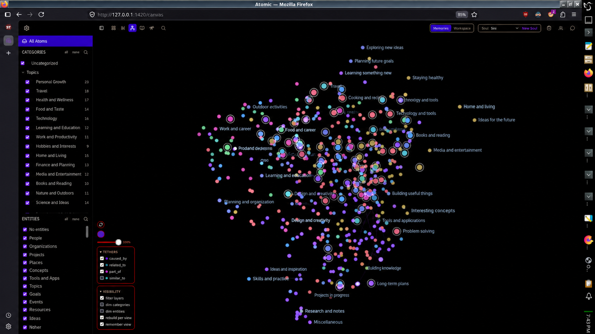

# Atomic Mind Map

## Seeing what she actually knows

Memory normally runs invisibly. That's good for continuity, but it means mistakes accumulate silently — she can be quietly wrong about you for months and neither of you would notice.

Atomic is the app the launcher opens in your browser at `http://127.0.0.1:1420` — the mind map, made real. Every memory she holds appears as a card: what she took from the conversation, when, and what it belongs to. You can read all of it. Search reaches her memories and her own workspace notes alike, loading more results as you scroll.

## Correcting her

You can edit any memory's text. The change takes effect immediately — she's working from the corrected version from that point on.

Deleting is careful, in the same spirit: a memory that one of her dossier summaries still cites refuses to be deleted until you clear the citation, so her written accounts never start referencing things that no longer exist. Memories that are merely filed under a dossier can be deleted outright — and deleting removes the memory and its earlier versions for good.

The review queue holds what she produces herself: memories she formed on her own that you haven't looked at yet, and her updated summaries.

## The canvas

Memories can also be viewed as a graph rather than a list. Related ones sit near each other, connected to similar memories and to the links she drew between them, grouped and colored by subject. Named people and topics are highlighted. It's the fastest way to see the shape of what she's built — which parts of your life she has a dense picture of, and which are thin.

*A real memory graph from an installation in daily use (identifying labels rewritten) — on an ordinary computer, not a hosted service. Click to open full size.*

## People and things

A separate panel lists everyone and everything she's recognized by name. You can correct a name, merge two entries that turn out to be the same person, or hide one you'd rather she stopped tracking.

Hiding destroys nothing - the history stays, she just stops noticing that name
going forward. Delete still refuses current mentions from active memories or
protected identity, relationship, dossier, or speaker uses. Otherwise it removes
the entity and its hidden links together; that history is permanently erased.

Merging shows you exactly what will move over before you confirm.

## Curating a dossier

Open one of her dossiers and you'll see the memories behind the summary — the ones it actually draws on first, then anything else filed there. Attaching a memory marks the dossier for rewriting at her next consolidation. You can only detach a memory the summary doesn't quote, so detaching doesn't need a rewrite. The two anchor dossiers — about her, and about you — can't be curated this way; she maintains them herself.

## Her own workspace

Atomic isn't only a window onto her memory - each soul gets a workspace of her
own in it. Her own notes, and real conversations with you, kept separate per
soul: switch souls and you switch workspaces. The memory tools stay open in
tabs while you work, instead of closing after every look. The workspace is
included in the OpenAlma Beta.

## Talking with her

Chat in Atomic uses the same model setup as the rest of OpenAlma: your API
provider, or Claude Code when it is turned on (`claude_code` in the memory
server's config, or **Use Claude Code** in SillyTavern). Each chat shows **API
mode** or **Claude Code mode**. Claude Code mode isn't available when the memory
server runs on Windows; use API mode there.

A chat is a *sitting* with a fixed amount of room. You set that room in the
memory server's config: `llm.context_window_tokens` for API mode,
`claude_code_context_window_tokens` for Claude Code. Use what your provider or
account really allows. OpenAlma keeps 20,000 tokens in reserve, and a meter in
the chat header shows how full the sitting is. Older messages are never quietly
dropped to make space. In Claude Code mode, older tool and thinking details are
cleaned up as the sitting fills; your conversation itself is kept.

When the sitting is full, she writes a short recap and the sitting closes. It
stays readable but takes no new messages. **Start new sitting** opens a fresh
one with the same topics and your unsent draft. A sitting stays in the mode it
started in: if you switch Claude Code on or off, switch it back to continue
that sitting, or start a new one.

Closing the browser tab doesn't cancel a reply in progress; it is saved when it
finishes.

## When you close it

**End Session** closes the sitting the same way: she writes a recap, and the
conversation is saved. The transcript joins ordinary memory processing; closing
a session does not itself start a paid extraction.

If failed memory work has paused her, a refused send restores your unsent draft
instead of making up an error reply from her. Recover in the launcher.
